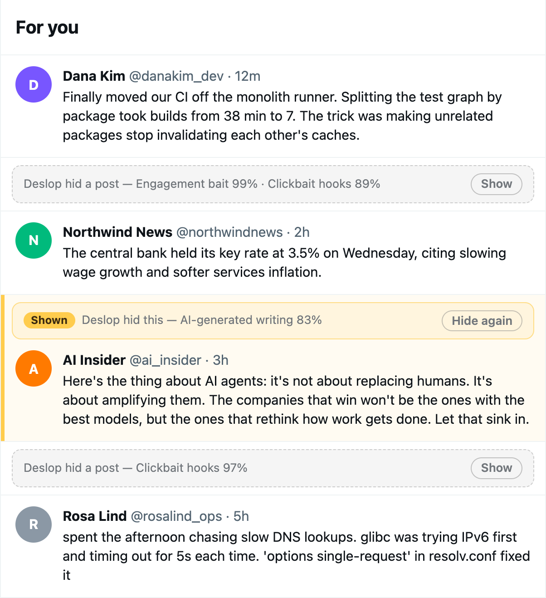
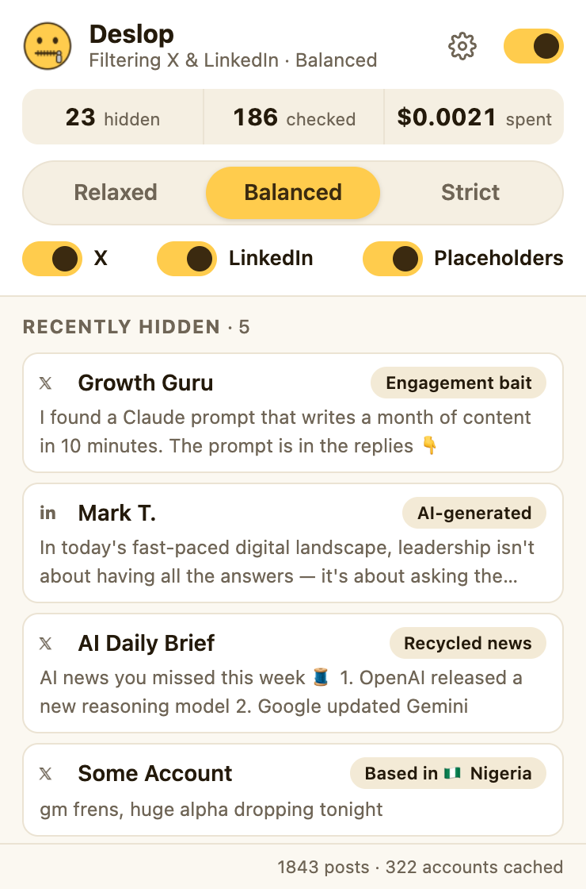
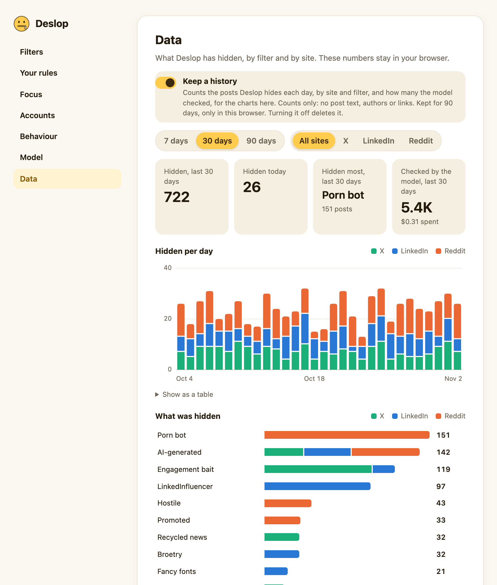
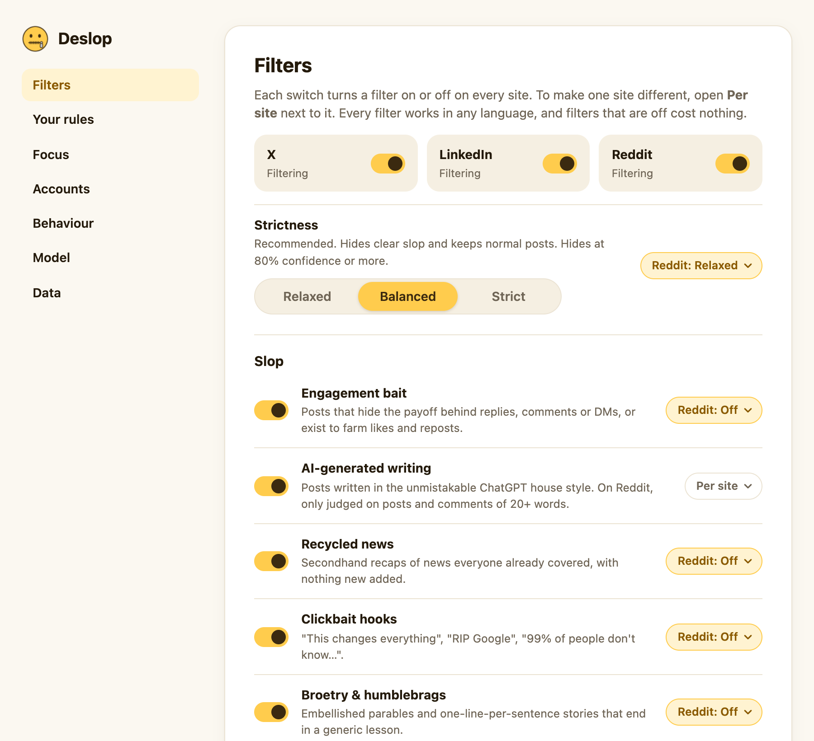

<p align="center"></p>

<h1 align="center">Deslop</h1>

<p align="center"><b>A Chrome extension that removes slop from X, LinkedIn and Reddit.</b><br>
Engagement bait, AI-written filler, hate and abuse, recycled news, clickbait hooks, broetry, Reddit's OnlyFans bots and, if you want, off-topic posts or posts from countries you choose, quietly disappear from your feed, in any language.<br>
Every post is judged by <a href="https://openrouter.ai/~typesafe/jev-latest">Jev</a>, TypeSafe's decision model, through OpenRouter, or by another decision model you pick or host yourself.</p>

<p align="center">
  
  &nbsp;
  
</p>

<p align="center"><sub>By default a hidden post leaves a placeholder. <b>Show</b> reveals it, marked in yellow with a <b>Hide again</b> button.</sub></p>

## What it hides

| Group | Category | Examples | Default |
| --- | --- | --- | --- |
| Slop (some not on Reddit, see [Reddit](#reddit)) | **Engagement bait** | "The prompt is in the replies 👇", "Comment GUIDE and I'll DM you", "Link in first comment", "Like if you agree" | On |
| | **AI-generated writing** | "In today's fast-paced landscape…", "It's not X, it's Y", emoji-bullet listicles, "Let that sink in" | On |
| | **Recycled news** | "🚨 OpenAI just dropped… here's everything you need to know 🧵", weekly "AI news you missed" roundups | On |
| | **Clickbait hooks** | "RIP Photoshop", "This changes everything", "99% of people don't know this" | On |
| | **Broetry & humblebrags** | "Yesterday I fired my best employee. Here's why." | On |
| | **Fancy fonts & emojis** | "🚀 𝗕𝗜𝗚 𝗡𝗘𝗪𝗦 🚀 I'm 𝘁𝗵𝗿𝗶𝗹𝗹𝗲𝗱 to share…": Unicode bold/italic "fonts" mixed with emojis, detected in code | On |
| | **LinkedInfluencers** | Chronic personal-brand posting: "i just spent 2 weeks on a reality show… there's a lot to unpack", name-dropping, vulnerability arcs, cliffhangers | On |
| | **Rage bait** | Inflammatory hot takes written to farm angry replies | Off |
| Hate & toxicity | **Hate speech & slurs** | Bigotry, dehumanizing language, slurs, including in a post being quoted | On |
| | **Hostile & abusive** | Insults, harassment, threats, "jokes" celebrating violence or sexual assault | On |
| | **Heavy profanity** | Posts full of swearing (a stray swear word is fine) | Off |
| | **Sexual content & porn bots** | Explicit posts, "check my bio 🔞" spam | Off |
| Topics & selling | **Sales pitches** | "My cohort opens tomorrow, DM me IN" | Off |
| | **Get-rich-quick & crypto pumps** | "$30k/month passive income", "this memecoin is about to 100x" | Off |
| | **Politics** | Elections, politicians, policy fights, culture-war debates | Off |
| | **Your own rules** | Anything you describe, e.g. *"Crypto or memecoin promotion"*, on every site or only the ones you pick. Matched on meaning: *Canada* also catches *Canadian*, *Toronto* or *加拿大* | — |
| | **Focus mode** | Everything that isn't about the interests you list (see below) | Off |
| | **Countries / regions** | Accounts based in countries or regions you pick (X and LinkedIn) | — |
| Reddit | **OnlyFans & porn-bot accounts** | Authors whose profile links to OnlyFans, Fansly, cam sites or another adult platform, or names one in their bio | On |
| | **Brand-new NSFW accounts** | Accounts under 30 days old whose profile is marked NSFW or hides its posts | On |

Plus muted words, an allowlist of accounts that are never hidden, and optional hiding of promoted posts.

### Different rules for each site

Every filter has one switch that applies to X, LinkedIn and Reddit at once. To make one site different, open **Per site** next to it and set that site to *On*, *Off* or *Same as all*. The button then says which sites differ (Reddit starts with five of them, see [Reddit](#reddit)), and those overrides stay put when you flip the main switch.

- **Strictness** works the same way: one level for every site, and any site can have its own (say, Strict on X and Relaxed on Reddit). The popup sets the level for every site.
- **Your own rules** can each be limited to some sites: *Politics* on X only, for example.
- **Focus** and the **country filter** each have their own *Apply on* sites, and each site has its own on/off switch at the top of **Filters**.

Settings are split into sections (Filters, Your rules, Focus, Accounts, Behaviour, Model, Data) picked from a side menu, so each fits on a screen or two.

### See what was hidden

Turn on **Keep a history** in **Data** and Deslop counts the posts it hides each day, by site and filter. It's off until you turn it on, it records counts only (no post text, authors or links), it keeps 90 days in your browser only, and turning it off deletes it. Without it, Data shows today's totals.

With it on, Data charts the last 7, 30 or 90 days, for every site or one: posts hidden per day, split by site, and how many each filter hid. Hover a column or bar (or use the arrow keys) for the numbers, or open the table under each chart. There are also tiles for today's count, the filter that hid the most, and how many posts the model checked and what that cost.

<p align="center"></p>

### Fancy fonts and LinkedInfluencers

𝐁𝐨𝐥𝐝, 𝘪𝘵𝘢𝘭𝘪𝘤 and 𝓈𝒸𝓇𝒾𝓅𝓉 "fonts" are really Unicode maths letters, and they're a heavy tell of LinkedIn-style slop. Deslop spots them in code, without asking Jev:

- **Fancy fonts mixed with emojis** score 0.90–0.99 and are hidden at every strictness, instantly and for free.
- **Fancy fonts without emojis** can be written by a person, so they aren't hidden on their own. Jev is told the post uses them (and reads the text as plain letters), and the **LinkedInfluencers** question decides whether the post is personal-brand performance: a crafted story about the author's journey, written to grow an audience, where the author is the product.

### Any language

Every filter works the same whatever language a post is written in:

- Each question tells Jev to apply the same standard in any language, and the examples include Spanish, Portuguese, French, German, Chinese and Japanese posts.
- Custom rules and focus interests are matched on meaning, so a rule written in English catches posts in Hindi or Spanish.
- Word counting uses `Intl.Segmenter`, so Chinese, Japanese and Thai posts (written without spaces) aren't skipped as "too short".
- Muted words match in scripts without spaces (Chinese, Japanese, Thai, Korean), treat full-width letters as normal ones (`ＢＴＣ` = `btc`), and keep accents meaningful (`año` ≠ `ano`).
- "Ad" / "Promoted" labels are recognised in about 40 interface languages.

### Placeholders

By default, a hidden post leaves a thin *Deslop hid a post* bar with the reasons and a **Show** button, so you can see what was caught. A post you show gets a yellow edge and a **Shown** tag so it stands out from the rest of your feed, plus a **Hide again** button. Switch **Placeholders** off in the popup to remove slop completely instead.

### Muted words

Muted words hide posts instantly, without asking Jev. They match whole words and their forms: a word of four or more letters also matches words up to three letters longer, so `canadian` mutes *Canadians*. Write `crypto*` to match any word starting with *crypto*, or put a word in double quotes (`"ai"`) to match only that exact word.

### Focus your feed

List what you want your feed to be about (for example *AI and LLMs*, *Startups and tech news*), switch on **Focus mode**, and Deslop hides posts that aren't about any of it. Choose how hard it filters (Light, Balanced or Strong) and which of X, LinkedIn and Reddit it applies on. Accounts on your allowlist are always shown.

### Tell X you're not interested

With this option on, every post Deslop hides on X also gets **⋯ → Not interested in this post**, exactly as if you'd clicked it, so X's For You timeline shows you less like it. Combined with Focus mode, this steers For You towards your interests over time.

- The menu is made invisible while this happens, and only an item whose text matches "Not interested" (in about 40 languages) is ever clicked.
- X only offers this item on For You. Elsewhere (Following, replies, search) the menu is closed again without clicking anything.
- Feedback is sent one post at a time, about a second apart.

### Reddit

Deslop works on the current www.reddit.com: Home, Popular, communities and comment threads. The filters above apply to posts (the title and the excerpt shown in the feed) and, with **Filter comments** on (the default), to comments. A hidden comment's text is replaced by the bar and its replies stay; in remove mode the comment goes, with its replies. The post you opened, your own posts and comments, and profile pages are never filtered.

Reddit is a forum, so asking the community, sharing news links and telling personal stories are what it's for. Some filters would flag ordinary posts there, so they start off on Reddit:

- **Engagement bait, Recycled news, Clickbait hooks, Broetry & humblebrags and LinkedInfluencers** start off. Reddit's feed also cuts posts off mid-text, which reads like "the rest is behind a click" to the engagement questions. You can still turn any of them on for Reddit in **Filters**.
- **AI-generated writing** is only judged on posts and comments of 20 words or more. An image's caption or a one-line reply says little about who wrote it, and image and link posts are judged on their title alone, since Deslop can't see the image.
- **Focus mode** only applies to posts, since comments are about their thread.

Hate and toxicity, rage bait, topics, your own rules, muted words and Focus still check everything, captions included.

Reddit's porn bots are brand-new accounts that hide their history and post harmless-looking questions to get people onto their profile, which links to OnlyFans. Deslop spots them from the author's profile, in code, without asking Jev:

- **OnlyFans & porn-bot accounts** hides posts by accounts whose profile links to OnlyFans, Fansly, Fanvue, ManyVids, a cam site or one of about 30 adult platforms, or names one in its bio (`𝐎𝐧𝐥𝐲𝐅𝐚𝐧𝐬` and `0nlyfans` included). A link-in-bio page (Linktree, AllMyLinks, Beacons…) counts only on a profile marked NSFW, since plenty of people use them.
- **Brand-new NSFW accounts** hides posts by accounts under 30 days old whose profile is marked NSFW or hides its posts and comments.
- **Check commenters' profiles too** (off by default) runs both checks on comment authors as well.

For this, Deslop reads each author's `about.json` (account age, NSFW flag, bio) and profile page (the links people add to their profile, which Reddit only shows there) from your Reddit tab, with your own session. Lookups only run for posts that pass the slop check, are spaced out (about one profile a second), stop at 1,000 profiles a day, pause whenever Reddit's rate-limit headers or a 429 say to slow down, and are cached for 14 days. Profiles never go to the model, and Reddit doesn't show people who viewed their profile.

Reddit doesn't say where accounts are based, so the country filter doesn't apply there.

## How it works

Jev isn't a chat model. It answers **typed questions** about a piece of text and returns **calibrated probabilities** (`noul` for yes/no, `score` for a graded scale, `choice` for picking an option) in about 100–400 ms.

Deslop asks Jev narrow questions about every post in **one request**, but only the questions for the categories you've turned on:

```
withholds_payoff    noul   Does the post hold back its point and push you to the replies/DMs/a thread?
engagement_farming  noul   Is it mainly fishing for likes, reposts, follows or comments?
ai_style            score  How strongly does the writing show ChatGPT-style tells? (0 human … 3 unmistakable)
news_rehash         noul   Is it secondhand news turned into a recap or hype post, adding nothing new?
clickbait_hook      noul   Does it open with a hype or curiosity-gap hook that overpromises?
hollow_inspiration  noul   Is it a formulaic "lessons learned" story or humblebrag?
personal_branding   noul   Is it personal-brand content from someone who treats posting as their job?
rage_bait           noul   Is it built to provoke outrage for engagement?
hate_speech         noul   Does it (or a post it quotes) demean people for who they are, or use slurs?
hostility           noul   Is it (or a post it quotes) insulting, threatening or celebrating violence?
profanity           noul   Is it dominated by profanity or crude language?
sexual_content      noul   Is it sexual, or adult-content spam?
self_promotion      noul   Is it mainly a pitch for the author's own course, product or newsletter?
get_rich_quick      noul   Does it promise easy money, passive income or a crypto pump?
politics            noul   Is it mainly about politics?
custom_<hash>       noul   One per custom rule: does the post fit the rule?
focus               noul   With Focus mode on: is the post about one of your interests?
```

The fancy-font check runs in code (`src/lib/classify.js`) before any request. The answers are combined in code (`src/lib/questions.js`). A post is hidden when any category that's on for its site passes the threshold for that site's strictness:

| Strictness | Hides at | AI-writing score |
| --- | --- | --- |
| Relaxed | ≥ 90 % | ≥ 0.80 |
| **Balanced** (default) | ≥ 80 % | ≥ 0.67 ("likely AI") |
| Strict | ≥ 65 % | ≥ 0.55 |

Raw answers are cached per post and per question for 14 days. Changing strictness or turning a category off never calls the model again; turning one on (or editing a rule or your interests) only asks that one question for posts you see again. Posts are blurred for the fraction of a second it takes to check them, so slop doesn't flash on screen.

**Cost:** about **$0.0001 per post** with the original seven questions (≈2,300 input tokens at $0.042/M). Each extra filter you turn on adds one short question to the same request, so cost grows a little with every filter, and filters that are off cost nothing. On Reddit every comment is checked like a post, so busy threads cost more; turn off **Filter comments** to check posts only. Today's spend is shown in the popup.

**Spending cap:** Deslop stops sending posts to OpenRouter for the rest of the day once today's spend reaches your cap, **$0.50 by default** (about 5,000 posts with Jev). Change it or turn it off under **Model** in settings. The day resets at your local midnight. Muted words, promoted posts and fancy fonts mixed with emojis are still hidden, because they're decided in code. The cap can be overshot by a fraction of a cent while the last few requests finish. Self-hosted servers have no cap, since they're free.

### Choosing a model

The **Model** card in settings has two options:

- **OpenRouter** (default). Pick any of OpenRouter's decision models from the list, which is loaded live, so new models appear without an update. Each one shows its approximate price per 1,000 posts. Jev Latest is recommended, because Deslop's questions and strictness levels are tuned for it. Models that need their own input format (ScaleDown, Respan) and retired models aren't listed. For anything else, pick **Other model ID…** and type it.
- **Your own server.** Any server that speaks the System One API (`POST /v1/systemone`), such as [Laya](https://pypi.org/project/laya/) (`pip install "laya[serve]"`, then `laya-serve`, which listens on port 8000), Unsloth Studio (Settings → API → Decision API), LocalAI, Ollama 0.35+ or SGLang. Enter the address (`localhost:8000` is enough: `/v1/systemone` is added for you), the model name and, if the server needs one, an API key. **Save & test** asks Chrome for permission to reach that host, and nothing is sent anywhere else. Self-hosted models are free, so spend shows $0.

Answers are cached separately for each model, so switching models never mixes their verdicts.

⚠️ **Self-hosted models are much weaker than Jev on Deslop's questions.** In our tests, Laya's answers barely separated slop from normal posts: at Relaxed and Balanced it hid none of the 30 slop fixtures, and at Strict it also hid 23 of the 24 normal ones. It also took 1.5–3.5 s per post on a Mac, close to the 4 s limit on how long Deslop blurs a post, so with several posts waiting some may show for a moment before they're hidden. The integration works; the model just isn't decisive enough on these questions yet.

### Country filter

- **X** shows an *"Account based in"* line on every account's *About this account* page. Deslop reads the same data x.com loads for that page, from your logged-in tab, once per account (cached for 45 days). X allows roughly 50 of these lookups per 15 minutes; Deslop respects the rate-limit headers, so a brand-new feed fills in gradually. Some accounts only disclose a region (e.g. "North America"). Enable *Also hide region-only accounts* to hide those when the region contains a country you blocked.
- **LinkedIn** doesn't show location in the feed, so Deslop reads the location line from the author's profile page (streaming only the first ~60 KB, at most 300 profiles a day, cached for 45 days). ⚠️ **LinkedIn may count this as a profile view.** If you don't want to show up in "Who viewed your profile", switch LinkedIn's profile viewing mode to private, or turn off *Apply on LinkedIn*.
- Places like "Toronto, Ontario, Canada" are matched in code. Vague ones like "Golden Horseshoe" or "Atlanta, Georgia" are resolved by asking Jev which of *your blocked countries* (if any) the place is in.
- Lookups only run for posts that pass the slop check, so hidden posts never cost a lookup.

## Install

1. Download `deslop-<version>.zip` from the [latest release](https://github.com/RZ3M/deslop/releases/latest) and unzip it, or clone this repo. For the newest build of `main`, rebuilt on every merge, get [`deslop-edge.zip`](https://github.com/RZ3M/deslop/releases/download/edge/deslop-edge.zip).
2. Open `chrome://extensions` and switch on **Developer mode** (top right).
3. Click **Load unpacked** and select the folder that contains `manifest.json`.
4. The settings page opens. Click **Connect OpenRouter**, sign in to OpenRouter and click **Authorize**: OpenRouter creates a key named "Deslop" for the extension (you can give it a credit limit on that page). Or paste an [API key](https://openrouter.ai/settings/keys) you already have and click **Save & test**, or switch to **Your own server** (see [Choosing a model](#choosing-a-model)).
5. Scroll X, LinkedIn or Reddit.

Works in Chrome, Edge, Brave, Arc and other Chromium browsers (Manifest V3, Chrome 111+).

<details>
<summary><b>Developer shortcut: use a key from a <code>.env</code> file</b></summary>

```powershell
pwsh scripts/import-env-key.ps1   # reads OPENROUTER_API_KEY from ./.env or ../.env
```

This writes `config.local.json` (gitignored). The unpacked extension imports it on first run, so you don't need to paste the key.
</details>

<p align="center"></p>

## Privacy

The full policy is in [PRIVACY.md](PRIVACY.md). In short:

- **Post text goes to OpenRouter and the model's maker** (or only to your own server, if you use one) to be classified: the author's display name and handle or headline, the post text, any quoted post, whether it has media and, on Reddit, its community. Nothing else from the page is sent.
- Your **API keys** stay in `chrome.storage.local`. The OpenRouter key is only sent to `openrouter.ai`, and a server key only to your server.
- Deslop only asks for access to your own server's host when you click **Save & test**, and only for that host.
- Verdicts, account locations and stats are stored **locally** in your browser, and the daily history behind the charts only if you turn it on. There's no Deslop server, analytics or telemetry.
- Country lookups and Reddit profile lookups use your own logged-in session from the tab you're browsing, just like opening the About or profile page yourself (see the LinkedIn profile-view note above). Reddit profiles are never sent to the model.

## Development

No build step. It's plain ES modules and Manifest V3.

```
manifest.json
src/
  background.js          service worker: classification, caching, country resolution, Reddit profile verdicts, stats
  lib/questions.js       ★ every Jev question and threshold, in one place
  lib/classify.js        post → Jev state, answers → verdict (pure, testable)
  lib/jev.js             Decision model client: OpenRouter or a System One server (retries, concurrency limit, model list)
  lib/connect.js         Connect OpenRouter (OAuth PKCE: creates a key in the user's account)
  lib/countries.js       countries, regions, place matching
  lib/profiles.js        Reddit profile rules: adult-platform links, bios, new NSFW accounts (pure, testable)
  lib/settings.js, cache.js
  content/common.js      engine: scan, blur, hide/collapse, country and profile checks
  content/x.js           X adapter + "Account based in" lookups
  content/x-main-world.js  learns X's current AboutAccountQuery id from x.com's own requests
  content/linkedin.js    LinkedIn adapter + profile-location lookups
  content/reddit.js      Reddit adapter (posts, comments, ads) + author-profile lookups
  popup/, options/, ui/  extension UI
tests/                   browser-based tests, and run.mjs to run them headlessly (see below)
scripts/                 package.ps1, check-manifest.mjs, serve.ps1, import-env-key.ps1, make-icons.sh
.github/workflows/       ci.yml (pull requests), release.yml (main)
```

### Tests

```sh
node tests/run.mjs          # offline tests in headless Chrome, Chromium, Edge or Brave (Node 22+)
node tests/run.mjs --live   # also the tests that call Jev; needs config.local.json or OPENROUTER_API_KEY
```

To open the pages in a browser instead:

```powershell
pwsh scripts/import-env-key.ps1          # tests that call Jev need config.local.json
pwsh scripts/serve.ps1                   # http://localhost:8787
```

| Page | What it checks | Status |
| --- | --- | --- |
| `/tests/unit.html` | Place matching, blocking rules, verdict composition, custom rules, focus mode, per-question caching, fancy fonts, word counts and muted words in many scripts, Reddit profile rules, the all-sites switches and per-site overrides, per-site strictness and rules, settings migration, limiter (offline) | 53/53 |
| `/tests/e2e-x-offline.html` | Real `background.js` + content scripts on a mock X timeline without Jev: muted word forms, ad labels in other languages, fancy fonts, "Not interested" feedback | 19/19 |
| `/tests/e2e-linkedin-offline.html` | Same on a mock LinkedIn feed: hidden posts don't flicker as the page changes, "Show" reveals a post and "Hide again" collapses it, in both hide modes, no daily history unless it's on | 31/31 |
| `/tests/e2e-reddit-offline.html` | Same on mock Reddit posts and comments that render through shadow DOM like Reddit's, with mock profiles: OnlyFans and Fansly links (including behind Reddit's redirect), bios, new NSFW and hidden-history accounts, comments and their replies, replies in a collapsed thread once it's expanded, ads, both hide modes, bars that line up with the post card, one lookup per profile, the opt-in daily history and deleting it | 52/52 |
| `/tests/harness.html` | 54 labelled posts (incl. hate, quoted hate, LinkedInfluencers, 8 languages) through the live model, at each strictness | 33/33 at Balanced on the original 33; new cases not yet run |
| `/tests/e2e-x.html` | Real `background.js` + content scripts on a mock X timeline, live Jev | 9/9 before the new cases; not yet re-run |
| `/tests/e2e-linkedin.html` | Same for LinkedIn, including profile-location parsing and author detection | 9/9 |
| `/src/popup/popup.html?shim` | Preview extension pages in a normal tab | — |

The extension was also loaded unpacked in a real Chromium browser and run against a mock `x.com` timeline, with the real content scripts, service worker and Jev.

### Builds and releases

Everything is done by GitHub Actions:

| When | What happens |
| --- | --- |
| A pull request is opened or updated | [`ci.yml`](.github/workflows/ci.yml) checks `manifest.json`, runs the offline tests and packages the extension. The zip is under the run's **Artifacts**, ready to load unpacked. |
| A change lands on `main` | [`release.yml`](.github/workflows/release.yml) runs the same checks, then updates the **edge** pre-release with a fresh `deslop-edge.zip`. |
| `main` has a `manifest.json` version that hasn't been released | The same run also creates release `v<version>` with `deslop-<version>.zip` and generated notes, and marks it Latest. |

To ship a release, bump `version` in `manifest.json` in your pull request and merge it. To run the live Jev tests in CI, add an `OPENROUTER_API_KEY` repository secret and run **CI** by hand from the Actions tab with *live* ticked (it costs a few cents).

### Tuning

If Deslop is too aggressive or too lenient on your feed, edit the wording, examples or thresholds in [`src/lib/questions.js`](src/lib/questions.js), add a labelled case to [`tests/fixtures.js`](tests/fixtures.js) and re-run the harness. Following TypeSafe's guidance, keep questions atomic: one judgment per question, combined in code.

## Known limitations

- X, LinkedIn and Reddit change their markup often. The adapters rely on `data-testid`s, roles, Reddit's custom elements and their attributes, and profile URLs rather than CSS classes, but a redesign can still break them.
- Reddit: old.reddit.com and search results aren't supported. The hidden-history signal relies on the wording of Reddit's profile page, and if Reddit renders profile links only after the page loads, the OnlyFans check falls back to the bio and the NSFW-account rule.
- X occasionally rotates the id of its `AboutAccountQuery`. Deslop learns the new one when you open any account's *About* page.
- Windows doesn't render flag emoji, so countries show as two-letter codes there.
- Text-only: images and videos aren't analysed. Posts with fewer than three words (counting a quoted post) are left alone, even in Focus mode.
- "Not interested" feedback relies on X's menu wording. If X renames the item, Deslop clicks nothing rather than guessing.

## License

[MIT](LICENSE)
