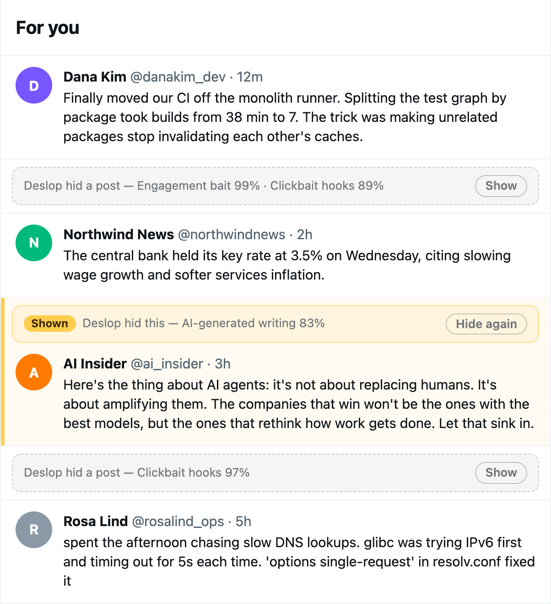
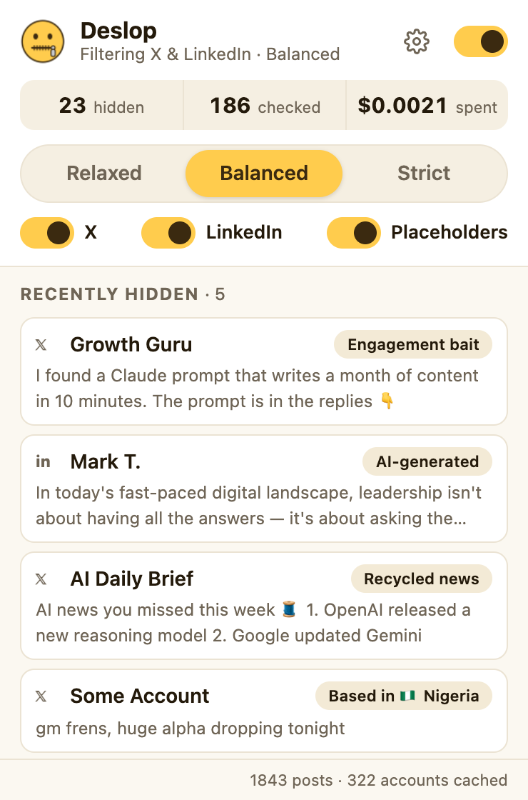
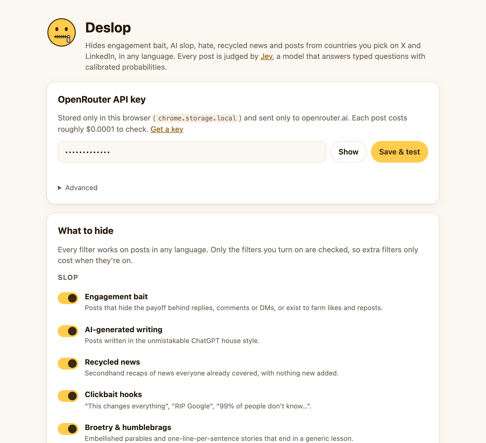

<p align="center"></p>

<h1 align="center">Deslop</h1>

<p align="center"><b>A Chrome extension that removes slop from X and LinkedIn.</b><br>
Engagement bait, AI-written filler, hate and abuse, recycled news, clickbait hooks, broetry and, if you want, off-topic posts or posts from countries you choose, quietly disappear from your feed, in any language.<br>
Every post is judged by <a href="https://openrouter.ai/~typesafe/jev-latest">Jev</a>, TypeSafe's decision model, through OpenRouter.</p>

<p align="center">
  
  &nbsp;
  
</p>

<p align="center"><sub>By default a hidden post leaves a placeholder. <b>Show</b> reveals it, marked in yellow with a <b>Hide again</b> button.</sub></p>

## What it hides

| Group | Category | Examples | Default |
| --- | --- | --- | --- |
| Slop | **Engagement bait** | "The prompt is in the replies 👇", "Comment GUIDE and I'll DM you", "Link in first comment", "Like if you agree" | On |
| | **AI-generated writing** | "In today's fast-paced landscape…", "It's not X, it's Y", emoji-bullet listicles, "Let that sink in" | On |
| | **Recycled news** | "🚨 OpenAI just dropped… here's everything you need to know 🧵", weekly "AI news you missed" roundups | On |
| | **Clickbait hooks** | "RIP Photoshop", "This changes everything", "99% of people don't know this" | On |
| | **Broetry & humblebrags** | "Yesterday I fired my best employee. Here's why." | On |
| | **Fancy fonts & emojis** | "🚀 𝗕𝗜𝗚 𝗡𝗘𝗪𝗦 🚀 I'm 𝘁𝗵𝗿𝗶𝗹𝗹𝗲𝗱 to share…": Unicode bold/italic "fonts" mixed with emojis, detected in code | On |
| | **LinkedInfluencers** | Chronic personal-brand posting: "i just spent 2 weeks on a reality show… there's a lot to unpack", name-dropping, vulnerability arcs, cliffhangers | On |
| | **Rage bait** | Inflammatory hot takes written to farm angry replies | Off |
| Hate & toxicity | **Hate speech & slurs** | Bigotry, dehumanizing language, slurs, including in a post being quoted | On |
| | **Hostile & abusive** | Insults, harassment, threats, "jokes" celebrating violence or sexual assault | On |
| | **Heavy profanity** | Posts full of swearing (a stray swear word is fine) | Off |
| | **Sexual content & porn bots** | Explicit posts, "check my bio 🔞" spam | Off |
| Topics & selling | **Sales pitches** | "My cohort opens tomorrow, DM me IN" | Off |
| | **Get-rich-quick & crypto pumps** | "$30k/month passive income", "this memecoin is about to 100x" | Off |
| | **Politics** | Elections, politicians, policy fights, culture-war debates | Off |
| | **Your own rules** | Anything you describe, e.g. *"Crypto or memecoin promotion"*. Matched on meaning: *Canada* also catches *Canadian*, *Toronto* or *加拿大* | — |
| | **Focus mode** | Everything that isn't about the interests you list (see below) | Off |
| | **Countries / regions** | Accounts based in countries or regions you pick | — |

Plus muted words, an allowlist of accounts that are never hidden, and optional hiding of promoted posts.

The hate and toxicity filters judge the whole post, **including any post it quotes**, so a two-word reaction quoting something vile is hidden too.

### Fancy fonts and LinkedInfluencers

𝐁𝐨𝐥𝐝, 𝘪𝘵𝘢𝘭𝘪𝘤 and 𝓈𝒸𝓇𝒾𝓅𝓉 "fonts" are really Unicode maths letters, and they're a heavy tell of LinkedIn-style slop. Deslop spots them in code, without asking Jev:

- **Fancy fonts mixed with emojis** score 0.90–0.99 and are hidden at every strictness, instantly and for free.
- **Fancy fonts without emojis** can be written by a person, so they aren't hidden on their own. Jev is told the post uses them (and reads the text as plain letters), and the **LinkedInfluencers** question decides whether the post is personal-brand performance: a crafted story about the author's journey, written to grow an audience, where the author is the product.

### Any language

Every filter works the same whatever language a post is written in:

- Each question tells Jev to apply the same standard in any language, and the examples include Spanish, Portuguese, French, German, Chinese and Japanese posts.
- Custom rules and focus interests are matched on meaning, so a rule written in English catches posts in Hindi or Spanish.
- Word counting uses `Intl.Segmenter`, so Chinese, Japanese and Thai posts (written without spaces) aren't skipped as "too short".
- Muted words match in scripts without spaces (Chinese, Japanese, Thai, Korean), treat full-width letters as normal ones (`ＢＴＣ` = `btc`), and keep accents meaningful (`año` ≠ `ano`).
- "Ad" / "Promoted" labels are recognised in about 40 interface languages.

### Placeholders

By default, a hidden post leaves a thin *Deslop hid a post* bar with the reasons and a **Show** button, so you can see what was caught. A post you show gets a yellow edge and a **Shown** tag so it stands out from the rest of your feed, plus a **Hide again** button. Switch **Placeholders** off in the popup to remove slop completely instead.

### Muted words

Muted words hide posts instantly, without asking Jev. They match whole words and their forms: a word of four or more letters also matches words up to three letters longer, so `canadian` mutes *Canadians*. Write `crypto*` to match any word starting with *crypto*, or put a word in double quotes (`"ai"`) to match only that exact word.

### Focus your feed

List what you want your feed to be about (for example *AI and LLMs*, *Startups and tech news*), switch on **Focus mode**, and Deslop hides posts that aren't about any of it. Choose how hard it filters (Light, Balanced or Strong) and whether it applies on X, LinkedIn or both. Accounts on your allowlist are always shown.

### Tell X you're not interested

With this option on, every post Deslop hides on X also gets **⋯ → Not interested in this post**, exactly as if you'd clicked it, so X's For You timeline shows you less like it. Combined with Focus mode, this steers For You towards your interests over time.

- The menu is made invisible while this happens, and only an item whose text matches "Not interested" (in about 40 languages) is ever clicked.
- X only offers this item on For You. Elsewhere (Following, replies, search) the menu is closed again without clicking anything.
- Feedback is sent one post at a time, about a second apart.

## How it works

Jev isn't a chat model. It answers **typed questions** about a piece of text and returns **calibrated probabilities** (`noul` for yes/no, `score` for a graded scale, `choice` for picking an option) in about 100–400 ms.

Deslop asks Jev narrow questions about every post in **one request**, but only the questions for the categories you've turned on:

```
withholds_payoff    noul   Does the post hold back its point and push you to the replies/DMs/a thread?
engagement_farming  noul   Is it mainly fishing for likes, reposts, follows or comments?
ai_style            score  How strongly does the writing show ChatGPT-style tells? (0 human … 3 unmistakable)
news_rehash         noul   Is it secondhand news turned into a recap or hype post, adding nothing new?
clickbait_hook      noul   Does it open with a hype or curiosity-gap hook that overpromises?
hollow_inspiration  noul   Is it a formulaic "lessons learned" story or humblebrag?
personal_branding   noul   Is it personal-brand content from someone who treats posting as their job?
rage_bait           noul   Is it built to provoke outrage for engagement?
hate_speech         noul   Does it (or a post it quotes) demean people for who they are, or use slurs?
hostility           noul   Is it (or a post it quotes) insulting, threatening or celebrating violence?
profanity           noul   Is it dominated by profanity or crude language?
sexual_content      noul   Is it sexual, or adult-content spam?
self_promotion      noul   Is it mainly a pitch for the author's own course, product or newsletter?
get_rich_quick      noul   Does it promise easy money, passive income or a crypto pump?
politics            noul   Is it mainly about politics?
custom_<hash>       noul   One per custom rule: does the post fit the rule?
focus               noul   With Focus mode on: is the post about one of your interests?
```

The fancy-font check runs in code (`src/lib/classify.js`) before any request. The answers are combined in code (`src/lib/questions.js`). A post is hidden when any enabled category passes the threshold for your strictness level:

| Strictness | Hides at | AI-writing score |
| --- | --- | --- |
| Relaxed | ≥ 90 % | ≥ 0.80 |
| **Balanced** (default) | ≥ 80 % | ≥ 0.67 ("likely AI") |
| Strict | ≥ 65 % | ≥ 0.55 |

Raw answers are cached per post and per question for 14 days. Changing strictness or turning a category off never calls the model again; turning one on (or editing a rule or your interests) only asks that one question for posts you see again. Posts are blurred for the fraction of a second it takes to check them, so slop doesn't flash on screen.

**Cost:** about **$0.0001 per post** with the original seven questions (≈2,300 input tokens at $0.042/M). Each extra filter you turn on adds one short question to the same request, so cost grows a little with every filter, and filters that are off cost nothing. Today's spend is shown in the popup.

### Country filter

- **X** shows an *"Account based in"* line on every account's *About this account* page. Deslop reads the same data x.com loads for that page, from your logged-in tab, once per account (cached for 45 days). X allows roughly 50 of these lookups per 15 minutes; Deslop respects the rate-limit headers, so a brand-new feed fills in gradually. Some accounts only disclose a region (e.g. "South Asia"). Enable *Also hide region-only accounts* to hide those when the region contains a country you blocked.
- **LinkedIn** doesn't show location in the feed, so Deslop reads the location line from the author's profile page (streaming only the first ~60 KB, at most 300 profiles a day, cached for 45 days). ⚠️ **LinkedIn may count this as a profile view.** If you don't want to show up in "Who viewed your profile", switch LinkedIn's profile viewing mode to private, or turn off *Apply on LinkedIn*.
- Places like "Toronto, Ontario, Canada" are matched in code. Vague ones like "Greater Chennai Area" or "Atlanta, Georgia" are resolved by asking Jev which of *your blocked countries* (if any) the place is in.
- Lookups only run for posts that pass the slop check, so hidden posts never cost a lookup.

## Install

1. Download `deslop-<version>.zip` from the [latest release](https://github.com/RZ3M/deslop/releases/latest) and unzip it, or clone this repo. For the newest build of `main`, rebuilt on every merge, get [`deslop-edge.zip`](https://github.com/RZ3M/deslop/releases/download/edge/deslop-edge.zip).
2. Open `chrome://extensions` and switch on **Developer mode** (top right).
3. Click **Load unpacked** and select the folder that contains `manifest.json`.
4. The settings page opens. Paste an [OpenRouter API key](https://openrouter.ai/settings/keys) and click **Save & test**.
5. Scroll X or LinkedIn.

Works in Chrome, Edge, Brave, Arc and other Chromium browsers (Manifest V3, Chrome 111+).

<details>
<summary><b>Developer shortcut: use a key from a <code>.env</code> file</b></summary>

```powershell
pwsh scripts/import-env-key.ps1   # reads OPENROUTER_API_KEY from ./.env or ../.env
```

This writes `config.local.json` (gitignored). The unpacked extension imports it on first run, so you don't need to paste the key.
</details>

<p align="center"></p>

## Privacy

- **Post text goes to OpenRouter/TypeSafe** to be classified: the author's display name and handle or headline, the post text, any quoted post, and whether it has media. Nothing else from the page is sent.
- Your **API key** stays in `chrome.storage.local` and is only sent to `openrouter.ai`.
- Verdicts, account locations and stats are stored **locally** in your browser. There's no Deslop server, analytics or telemetry.
- Country lookups use your own logged-in X/LinkedIn session from the tab you're browsing, just like opening the About or profile page yourself (see the LinkedIn profile-view note above).

## Development

No build step. It's plain ES modules and Manifest V3.

```
manifest.json
src/
  background.js          service worker: classification, caching, country resolution, stats
  lib/questions.js       ★ every Jev question and threshold, in one place
  lib/classify.js        post → Jev state, answers → verdict (pure, testable)
  lib/jev.js             OpenRouter Decisions API client (retries, concurrency limit)
  lib/countries.js       countries, regions, place matching
  lib/settings.js, cache.js
  content/common.js      engine: scan, blur, hide/collapse, country check
  content/x.js           X adapter + "Account based in" lookups
  content/x-main-world.js  learns X's current AboutAccountQuery id from x.com's own requests
  content/linkedin.js    LinkedIn adapter + profile-location lookups
  popup/, options/, ui/  extension UI
tests/                   browser-based tests, and run.mjs to run them headlessly (see below)
scripts/                 package.ps1, check-manifest.mjs, serve.ps1, import-env-key.ps1, make-icons.sh
.github/workflows/       ci.yml (pull requests), release.yml (main)
```

### Tests

```sh
node tests/run.mjs          # offline tests in headless Chrome, Chromium, Edge or Brave (Node 22+)
node tests/run.mjs --live   # also the tests that call Jev; needs config.local.json or OPENROUTER_API_KEY
```

To open the pages in a browser instead:

```powershell
pwsh scripts/import-env-key.ps1          # tests that call Jev need config.local.json
pwsh scripts/serve.ps1                   # http://localhost:8787
```

| Page | What it checks | Status |
| --- | --- | --- |
| `/tests/unit.html` | Place matching, blocking rules, verdict composition, custom rules, focus mode, per-question caching, fancy fonts, word counts and muted words in many scripts, limiter (offline) | 33/33 |
| `/tests/e2e-x-offline.html` | Real `background.js` + content scripts on a mock X timeline without Jev: muted word forms, ad labels in other languages, fancy fonts, "Not interested" feedback | 16/16 |
| `/tests/e2e-linkedin-offline.html` | Same on a mock LinkedIn feed: hidden posts don't flicker as the page changes, "Show" reveals a post and "Hide again" collapses it, in both hide modes | 19/19 |
| `/tests/harness.html` | 54 labelled posts (incl. hate, quoted hate, LinkedInfluencers, 8 languages) through the live model, at each strictness | 33/33 at Balanced on the original 33; new cases not yet run |
| `/tests/e2e-x.html` | Real `background.js` + content scripts on a mock X timeline, live Jev | 9/9 before the new cases; not yet re-run |
| `/tests/e2e-linkedin.html` | Same for LinkedIn, including profile-location parsing and author detection | 9/9 |
| `/src/popup/popup.html?shim` | Preview extension pages in a normal tab | — |

The extension was also loaded unpacked in a real Chromium browser and run against a mock `x.com` timeline, with the real content scripts, service worker and Jev.

### Builds and releases

Everything is done by GitHub Actions:

| When | What happens |
| --- | --- |
| A pull request is opened or updated | [`ci.yml`](.github/workflows/ci.yml) checks `manifest.json`, runs the offline tests and packages the extension. The zip is under the run's **Artifacts**, ready to load unpacked. |
| A change lands on `main` | [`release.yml`](.github/workflows/release.yml) runs the same checks, then updates the **edge** pre-release with a fresh `deslop-edge.zip`. |
| `main` has a `manifest.json` version that hasn't been released | The same run also creates release `v<version>` with `deslop-<version>.zip` and generated notes, and marks it Latest. |

To ship a release, bump `version` in `manifest.json` in your pull request and merge it. To run the live Jev tests in CI, add an `OPENROUTER_API_KEY` repository secret and run **CI** by hand from the Actions tab with *live* ticked (it costs a few cents).

### Tuning

If Deslop is too aggressive or too lenient on your feed, edit the wording, examples or thresholds in [`src/lib/questions.js`](src/lib/questions.js), add a labelled case to [`tests/fixtures.js`](tests/fixtures.js) and re-run the harness. Following TypeSafe's guidance, keep questions atomic: one judgment per question, combined in code.

## Known limitations

- X and LinkedIn change their markup often. The adapters rely on `data-testid`s, roles and profile URLs rather than CSS classes, but a redesign can still break them.
- X occasionally rotates the id of its `AboutAccountQuery`. Deslop learns the new one when you open any account's *About* page.
- Windows doesn't render flag emoji, so countries show as two-letter codes there.
- Text-only: images and videos aren't analysed (Jev is a text model). Posts with fewer than three words (counting a quoted post) are left alone, even in Focus mode.
- "Not interested" feedback relies on X's menu wording. If X renames the item, Deslop clicks nothing rather than guessing.

## License

[MIT](LICENSE)
